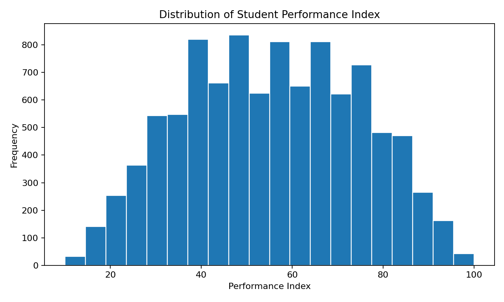

# Student Performance Analysis | Python Exploratory Data Analysis

**STAT 5606 Final Project** · Python · Pandas · NumPy · Matplotlib · Seaborn · Data Cleaning · EDA

## Project Overview

This project explores a publicly available student performance dataset to understand its structure, assess data quality, and visualize the distribution of the **Performance Index**. The workflow demonstrates foundational Python analytics skills, including data inspection, missing-value checks, duplicate removal, descriptive statistics, and exporting a cleaned dataset.

## Dataset

Source: [Student Performance Dataset on Kaggle](https://www.kaggle.com/datasets/neurocipher/student-performance/data)

The dataset includes six variables:

| Variable | Description |
| --- | --- |
| Hours Studied | Study hours |
| Previous Scores | Previous academic scores |
| Extracurricular Activities | Participation (Yes/No) |
| Sleep Hours | Sleep duration |
| Sample Question Papers Practiced | Number of practice papers |
| Performance Index | Student performance outcome |

## Data Cleaning Results

| Quality check | Result |
| --- | ---: |
| Original observations | 10,000 |
| Variables | 6 |
| Missing values | 0 |
| Duplicate rows removed | 127 |
| Cleaned observations | 9,873 |

The cleaned CSV retains the six original columns and excludes exact duplicate rows.

## Analysis Workflow

1. Load the CSV and inspect dataset shape, variable names, and data types.
2. Summarize numerical variables with descriptive statistics.
3. Check missing values and remove duplicate records.
4. Convert text-based columns to categorical data types.
5. Identify the Performance Index outcome and plot its distribution.
6. Export the cleaned dataset for subsequent analysis.

## Visualization

*The histogram illustrates the distribution of the Performance Index after removing duplicate rows. It is descriptive and does not establish causal relationships.*

## Repository Files

| File | Purpose |
| --- | --- |
| [`student_performance_eda.ipynb`](student_performance_eda.ipynb) | Jupyter Notebook with the original data-cleaning and EDA workflow |
| [`StudentPerformance.csv`](StudentPerformance.csv) | Original dataset |
| [`student_performance_cleaned.csv`](student_performance_cleaned.csv) | Cleaned dataset |
| [`images/performance_distribution.png`](images/performance_distribution.png) | Performance Index distribution |
| [`requirements.txt`](requirements.txt) | Python dependencies |

## How to Run

1. Download or clone this repository.
2. Install dependencies: `pip install -r requirements.txt`.
3. Open `student_performance_eda.ipynb` in Jupyter Notebook or Google Colab.
4. Keep `StudentPerformance.csv` in the notebook's working directory, then run the cells in order.

## Scope and Limitations

This is an **exploratory data analysis** project, not a predictive machine-learning model. The notebook does not evaluate correlations, estimate causal effects, train a model, or report prediction accuracy. Additional work could examine relationships between the explanatory variables and student performance.

## Skills Demonstrated

Python · Pandas · NumPy · Data Cleaning · Data Quality Assessment · Descriptive Statistics · Matplotlib · Seaborn · Jupyter Notebook
